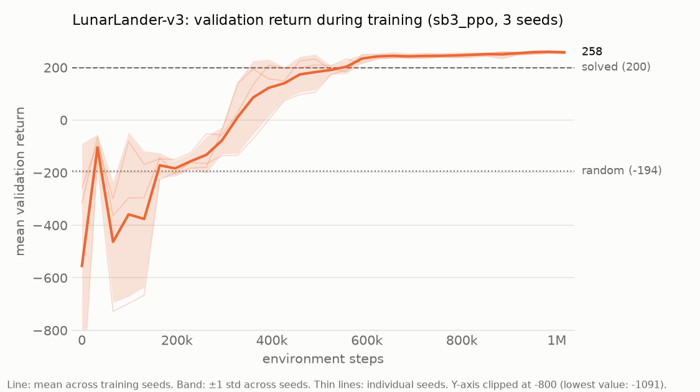

# lunar-lander-rl

**Deep Q-Networks and Proximal Policy Optimization implemented from scratch in PyTorch to solve Gymnasium's `LunarLander-v3`, with multi-seed evaluation, ablations and robustness tests.**

| Random agent | Trained agent (SB3 PPO baseline) |
|:---:|:---:|
|  |  |

<!-- TODO phase 3: replace / extend with the from-scratch DQN and PPO agents. -->

This is not another stable-baselines3 tutorial. The goals of the project are:

1. **From-scratch implementations** of DQN and PPO in PyTorch. Stable-Baselines3 is used only as a reference baseline.
2. **Experimental rigor**: several training seeds, mean ± std, and evaluation on episode seeds that are disjoint from the ones used for training and model selection.
3. **Ablations**: target network, network size, learning rate, ...
4. **Robustness**: train without wind, evaluate under wind and turbulence.
5. **Reproducibility**: everything is driven by YAML configs and fixed seeds.

## Status

| Phase | Content | Status |
|---|---|---|
| 1 | Setup, random agent, SB3 PPO baseline, evaluation pipeline, GIFs | ✅ done |
| 2 | DQN from scratch (target: mean return > 200) | ⏳ next |
| 3 | PPO from scratch + comparison with SB3 | ⬜ |
| 4 | Ablations, robustness to wind, final figures | ⬜ |

## Results

Final evaluation: **100 episodes on held-out test seeds 10000–10099**, deterministic (greedy) actions. For trained agents the score is averaged per training seed, and the ± is the standard deviation **across training seeds** (how reliable the algorithm is), not across episodes.

| Agent | Train seeds | Mean return | Success rate (return ≥ 200) |
|---|:---:|---:|---:|
| Random | – | -194.3 ± 121.4 *(std over episodes)* | 0% |
| SB3 PPO (baseline) | 3 | **258.7 ± 4.5** | 99.7% |
| DQN (ours) | – | <!-- TODO phase 2 --> | |
| PPO (ours) | – | <!-- TODO phase 3 --> | |

Per training seed, SB3 PPO scores 259.1, 254.0 and 263.0 on the test seeds. Training takes about 9 minutes per seed on a laptop CPU (Ryzen 9 6900HX, three seeds in parallel).

Raw per-episode results are in [`results/eval/`](results/eval) and the summary in [`results/summary.csv`](results/summary.csv).

### Learning curve



<!-- TODO phase 3: DQN vs PPO (ours) vs SB3 PPO on the same axes. -->

### Ablations

<!-- TODO phase 4 -->

### Robustness to wind

<!-- TODO phase 4: agents trained without wind, evaluated with enable_wind=True at increasing wind_power / turbulence_power. -->

## Methodology

### Environment

`LunarLander-v3` with discrete actions (do nothing, fire left, fire main, fire right) and an 8-dimensional state: position, velocity, angle, angular velocity and leg contacts. Episodes end on landing, crashing or after 1000 steps. The environment is considered **solved at a mean return of 200**.

### Seed protocol

Three disjoint seed ranges are used, so that no reported number was also used to make a decision:

| Purpose | Seeds | Used for |
|---|---|---|
| Training | 0, 1, 2 | Network initialization, exploration, terrains seen in training |
| Validation | 1000–1009 | Periodic evaluation during training → choosing the best checkpoint |
| Test | 10000–10099 | Final reported numbers only |

Selecting the best checkpoint and reporting its score on the same episodes would overestimate performance (selection bias), the same reason validation and test sets are separated in supervised learning. Every evaluation episode is reset with an explicit seed, so all agents face exactly the same 100 terrains and initial pushes.

### Baseline hyperparameters (SB3 PPO)

Taken from the tuned [RL Baselines3 Zoo](https://github.com/DLR-RM/rl-baselines3-zoo) configuration for LunarLander, so the baseline is strong. See [`configs/sb3_ppo.yaml`](configs/sb3_ppo.yaml) for the rationale behind each value: 16 parallel envs, `n_steps=1024`, `gamma=0.999` (the landing bonus arrives late in long episodes), `gae_lambda=0.98`, `ent_coef=0.01`, 1M steps.

## Installation

Requires Python 3.11. With [uv](https://docs.astral.sh/uv/) (recommended):

```bash
uv sync
```

Or with pip:

```bash
python -m venv .venv
.venv\Scripts\activate        # Windows  (Linux/macOS: source .venv/bin/activate)
pip install -e . pytest
```

`gymnasium[box2d]` now ships prebuilt Box2D wheels, so neither SWIG nor a C++ compiler is needed.

## Usage

Prefix commands with `uv run` if you use uv.

```bash
# Train the SB3 PPO baseline on seeds 0, 1, 2 (in parallel processes)
python -m lunar_rl.train_sb3 --config configs/sb3_ppo.yaml --workers 3

# Quick smoke test: one seed, 50k steps, any config value can be overridden
python -m lunar_rl.train_sb3 --config configs/sb3_ppo.yaml --seed 0 --set train.total_timesteps=50000

# Evaluate on the 100 held-out test seeds (CSV per model + results/summary.csv)
python -m lunar_rl.evaluate --agent random
python -m lunar_rl.evaluate --agent sb3_ppo --model "models/sb3_ppo/seed_*/best_model.zip"

# Evaluate under wind
python -m lunar_rl.evaluate --agent sb3_ppo --model "models/sb3_ppo/seed_*/best_model.zip" --wind --wind-power 15 --turbulence-power 1.5

# Learning curve (mean ± std across seeds) -> results/figures/
python -m lunar_rl.plot_curves --algo sb3_ppo

# Record a GIF
python -m lunar_rl.record --agent sb3_ppo --model models/sb3_ppo/seed_0/best_model.zip --out assets/sb3_ppo.gif

# Training curves in TensorBoard
tensorboard --logdir runs

# Tests
pytest
```

<!-- TODO phase 4: single "reproduce everything" command. -->

## Project structure

```
src/lunar_rl/
├── agents/          # Agent protocol, random agent, SB3 adapter; dqn.py / ppo.py (phases 2-3)
├── envs.py          # make_env: seeding + wind options
├── train_sb3.py     # SB3 PPO baseline with periodic validation and best checkpoint
├── evaluate.py      # evaluate any agent on fixed test seeds -> CSV
├── record.py        # GIF of one episode
├── plot_curves.py   # learning curves across seeds
└── utils/           # seeding protocol, config loader, logging
configs/             # one YAML per experiment
results/             # CSVs (curves, evaluations, summary) and figures (versioned)
assets/              # GIFs for this README
tests/
```

Trained models (`models/`) and TensorBoard logs (`runs/`) are not versioned; they are regenerated by the training command.

## License

[MIT](LICENSE)
