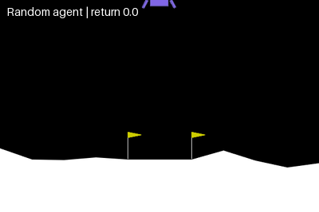
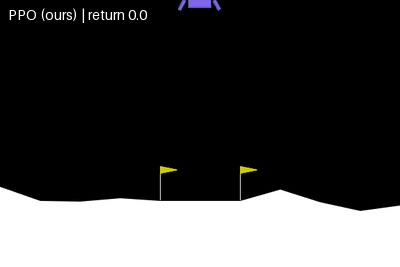
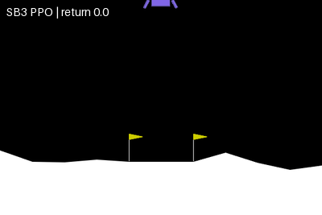
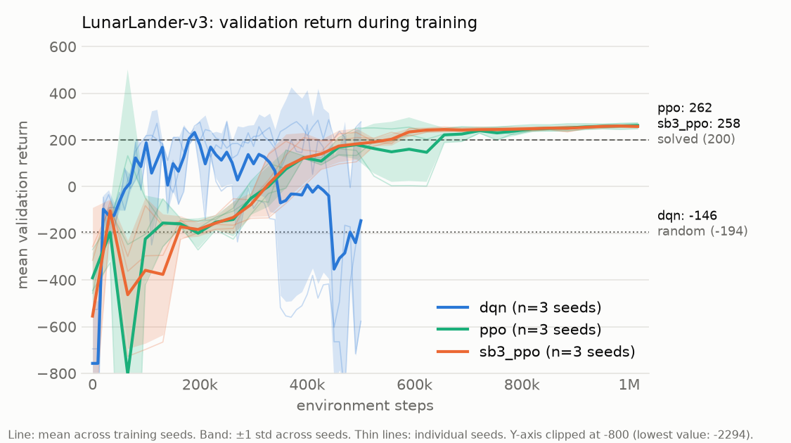
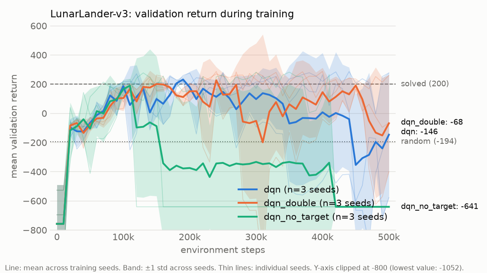
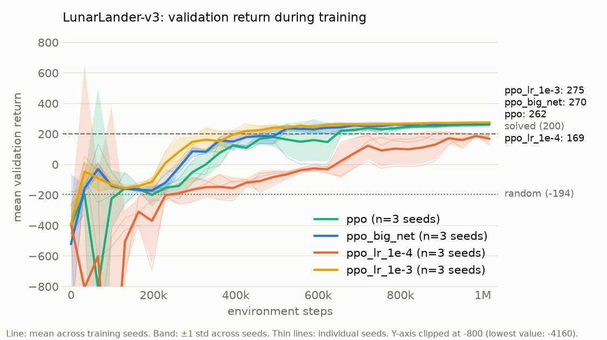
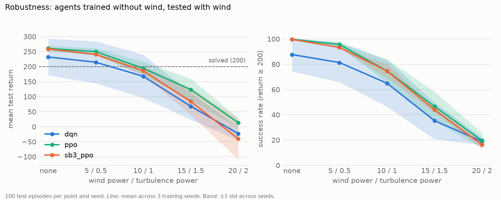

# lunar-lander-rl

[](https://github.com/andresbxa/lunar-lander-rl/actions/workflows/tests.yml)

**Deep Q-Networks and Proximal Policy Optimization implemented from scratch in PyTorch to solve Gymnasium's `LunarLander-v3`, with multi-seed evaluation, ablations and robustness tests.**

| Random agent | DQN (from scratch) |
|:---:|:---:|
|  |  |
| **PPO (from scratch)** | **PPO (SB3 baseline)** |
|  |  |

All four GIFs show the same episode: the first test seed (10000), not a hand-picked one.

This is not another stable-baselines3 tutorial. The goals of the project are:

1. **From-scratch implementations** of DQN and PPO in PyTorch. Stable-Baselines3 is used only as a reference baseline.
2. **Experimental rigor**: several training seeds, mean ± std, and evaluation on episode seeds that are disjoint from the ones used for training and model selection.
3. **Ablations**: target network, network size, learning rate, ...
4. **Robustness**: train without wind, evaluate under wind and turbulence.
5. **Reproducibility**: everything is driven by YAML configs and fixed seeds.

## Status

| Phase | Content | Status |
|---|---|---|
| 1 | Setup, random agent, SB3 PPO baseline, evaluation pipeline, GIFs | ✅ done |
| 2 | DQN from scratch (target: mean return > 200) | ✅ done: 232.0 ± 61.0, unstable across seeds (see below) |
| 3 | PPO from scratch + comparison with SB3 | ✅ done: 260.4 ± 9.6, on par with SB3 (258.7 ± 4.5) |
| 4 | Ablations, robustness to wind, final figures, reproduction script, CI | ✅ done |

## Results

Final evaluation: **100 episodes on held-out test seeds 10000–10099**, deterministic (greedy) actions. For trained agents the score is averaged per training seed, and the ± is the standard deviation **across training seeds** (how reliable the algorithm is), not across episodes.

| Agent | Train seeds | Mean return | Success rate (return ≥ 200) |
|---|:---:|---:|---:|
| Random | – | -194.3 ± 121.4 *(std over episodes)* | 0% |
| DQN (ours) | 3 | **232.0 ± 61.0** | 87.7% |
| PPO (ours) | 3 | **260.4 ± 9.6** | 99.7% |
| SB3 PPO (baseline) | 3 | **258.7 ± 4.5** | 99.7% |

Per training seed on the test seeds:

| Agent | Seed 0 | Seed 1 | Seed 2 | Wall-clock per seed |
|---|---:|---:|---:|---:|
| DQN, ours (500k steps) | 266.1 | 161.6 | 268.3 | ~53 min |
| PPO, ours (1M steps) | 269.8 | 250.7 | 260.8 | ~9.5 min |
| SB3 PPO (1M steps) | 259.1 | 254.0 | 263.0 | ~9 min |

Timings are on a laptop CPU (Ryzen 9 6900HX), three seeds in parallel. DQN is slower in wall-clock time despite using half the environment steps: it performs one gradient update per environment step, while PPO collects 16k steps and then updates in large batches.

### Key findings

- **Our PPO matches Stable-Baselines3.** With identical hyperparameters, budget and seeds, it scores 260.4 ± 9.6 against SB3's 258.7 ± 4.5. The 1.7-point gap is well below the spread across training seeds, and the learning curves overlap almost everywhere. The early training diagnostics also track SB3's closely (approximate KL 0.004–0.009, clip fraction 4–7%, entropy falling from ln 4 ≈ 1.386, value loss dropping from about 5000 to 800 over the first four updates).
- **DQN learns faster per environment step, PPO is far more reliable.** The mean validation return across seeds first exceeds 200 after 180k steps for DQN and after about 560k steps for both PPO implementations. But each PPO implementation's seeds end within 20 points of each other, while DQN's spread is 107 points.
- **Vanilla DQN collapses.** Two of the three DQN seeds learned to land and then suddenly degraded to returns below -400 (a well-known failure mode of Q-learning, linked to overestimated Q-values and a non-stationary target). Exploration was already at its minimum, so this is not caused by random actions.
- **Checkpoint selection on validation seeds matters for unstable algorithms.** Evaluated on the same test seeds, the *final* DQN weights score **-128.5 ± 402.8**, while the *best-on-validation* checkpoints score **232.0 ± 61.0**. The validation seeds are disjoint from the test seeds, so this gain is not selection bias on the reported number. For our PPO, the best checkpoint was the final one in all three seeds: a stable algorithm does not need rescuing.
- **One DQN seed misses the bar.** Seed 1's best checkpoint scored 218 on 10 validation episodes but 161.6 on the 100 test episodes (73% success): 10 validation episodes are a noisy basis for selecting a checkpoint when the policy is unstable.

Raw per-episode results are in [`results/eval/`](results/eval) and the summary in [`results/summary.csv`](results/summary.csv).

### Learning curves



Other figures: [PPO (ours) vs SB3 PPO](results/figures/learning_curve_ppo_vs_sb3_ppo.png), [DQN](results/figures/learning_curve_dqn.png), [PPO (ours)](results/figures/learning_curve_ppo.png), [SB3 PPO](results/figures/learning_curve_sb3_ppo.png). The y-axis is clipped at -800 so that a few very negative early evaluations do not squash the interesting range; each figure states the true minimum.

### Ablations

Each variant changes **one** setting of its base configuration ([`configs/ablations.yaml`](configs/ablations.yaml)) and is trained on the same 3 seeds. Every run is evaluated on the test episodes twice:

- the **best checkpoint** selected on validation, which is the peak performance that model selection can recover (and what the main results report);
- the **final weights**, which measure stability. A run that collapses late can still have a good best checkpoint, so this column is what reveals instability.

| Run | Change | Best checkpoint | Δ best | Final weights | Δ final | Verdict (best / final) |
|---|---|---:|---:|---:|---:|---|
| **`dqn`** | baseline | 232.0 ± 61.0 | – | -128.5 ± 402.8 | – | – |
| **`ppo`** | baseline | 260.4 ± 9.6 | – | 260.4 ± 9.6 | – | – |
| `dqn_double` | Double DQN targets | 256.3 ± 37.6 | +24.4 | -90.9 ± 322.0 | +37.6 | inconclusive / inconclusive |
| `dqn_no_target` | no target network (TD targets from the online network) | 231.5 ± 27.0 | -0.5 | -563.0 ± 0.0 | -434.6 | inconclusive / worse (likely real) |
| `ppo_big_net` | network 256-256 instead of 64-64 | 270.9 ± 0.6 | +10.5 | 270.7 ± 1.1 | +10.2 | better (likely real) / better (likely real) |
| `ppo_lr_1e-4` | learning rate 1e-4 instead of 3e-4 | 180.5 ± 11.6 | -79.9 | 169.3 ± 8.2 | -91.1 | worse (likely real) / worse (likely real) |
| `ppo_lr_1e-3` | learning rate 1e-3 instead of 3e-4 | 275.5 ± 2.6 | +15.1 | 274.9 ± 3.8 | +14.4 | better (likely real) / better (likely real) |
| `ppo_gamma_0.99` | gamma 0.99 instead of 0.999 | 239.6 ± 25.5 | -20.8 | 237.1 ± 26.9 | -23.3 | inconclusive / inconclusive |

Mean test return ± std across 3 training seeds. **Verdict rule:** with only 3 seeds, a difference is called *likely real* only if it is larger than the across-seed std of both the variant and its baseline; otherwise it is reported as *inconclusive* rather than presented as a finding. The table is generated by `python -m lunar_rl.ablate --report`.





What the ablations show:

- **Without a target network, DQN diverges.** All three seeds learn to land (the best checkpoints still score 231.5) and then diverge, at 115k, 156k and 419k steps respectively (first step with mean Q above 1000): their Q-values reach 10⁹–10¹¹, and the three final networks all collapse to the same degenerate policy ("always fire the right engine"), which is why their final scores are identical (-563.0). This is the textbook instability of combining function approximation, bootstrapping and off-policy learning (the "deadly triad"), and it is invisible in the best-checkpoint column.
- **The late collapses of DQN coincide with Q-value blow-ups.** In the baseline, the stable seed keeps its mean Q around 40, while the two seeds that collapse reach about 2700 and 350 (the returns are at most around 300). Double DQN shows the same pattern in two of its three seeds (peaks around 700 and 1300), so in this setting it softens overestimation but does not prevent the collapses; its improvement is inconclusive.
- **PPO is robust to its hyperparameters in one direction only.** A larger network or a larger learning rate both help slightly and consistently (all seeds within a few points), while lr 1e-4 is clearly too slow for a 1M-step budget. The long horizon (gamma 0.999) appears to help, but the gap is within the seed noise.

Raw results: [`results/ablations.csv`](results/ablations.csv) and per-episode files in [`results/eval/ablations/`](results/eval/ablations).

### Robustness to wind

All agents were trained **without wind** and then evaluated, without retraining, on the same 100 test episodes under increasing wind. With the same episode seed every agent faces exactly the same gusts, so the comparison between algorithms is paired.



Mean test return ± std across the 3 training seeds (success rate in parentheses):

| Wind / turbulence power | DQN (ours) | PPO (ours) | SB3 PPO |
|---|---:|---:|---:|
| none | 232.0 ± 61.0 (88%) | 260.4 ± 9.6 (100%) | 258.7 ± 4.5 (100%) |
| 5 / 0.5 | 214.6 ± 70.0 (81%) | 249.9 ± 11.1 (96%) | 240.7 ± 3.4 (93%) |
| 10 / 1.0 | 167.7 ± 71.9 (65%) | 194.3 ± 22.1 (75%) | 186.0 ± 14.2 (75%) |
| 15 / 1.5 | 68.1 ± 44.4 (35%) | 123.6 ± 35.5 (47%) | 84.3 ± 44.0 (44%) |
| 20 / 2.0 | -23.1 ± 22.2 (19%) | 13.3 ± 16.5 (20%) | -40.3 ± 68.2 (16%) |

- **Every agent degrades sharply under distribution shift.** Light wind is tolerated, but at moderate wind (10 / 1.0) no algorithm stays above 200, and at the maximum wind only about one landing in five succeeds. None of them ever experienced wind during training.
- **The ranking is stable across wind levels** (PPO ≳ SB3 PPO > DQN), but the gap between our PPO and SB3 is within the across-seed spread at every level, so it should not be read as "our PPO is more robust".
- The no-wind column reproduces the main results table exactly, a consistency check of the evaluation pipeline.

Raw results: [`results/robustness.csv`](results/robustness.csv) and per-episode files in [`results/eval/robustness/`](results/eval/robustness).

## Conclusions and limitations

**Conclusions**

1. A from-scratch PPO that mirrors SB3's implementation details matches SB3 within noise (260.4 ± 9.6 vs 258.7 ± 4.5), with nearly identical learning curves and training diagnostics.
2. DQN reaches good policies with fewer environment steps but is unstable: its runs can collapse late, and the collapses coincide with exploding Q-values. Selecting the checkpoint on validation seeds rescues the final score (from -128.5 to 232.0) but does not fix the instability, and the target network is essential (without it, all seeds diverge).
3. All agents trained without wind degrade sharply under wind: no algorithm stays above 200 at moderate wind. Robustness has to be trained for (for example with wind during training or domain randomization); it does not emerge from solving the calm task.

**Limitations**

- **3 training seeds** per configuration: enough to expose large effects and instability, not to resolve small differences, hence the conservative verdict rule.
- **Validation uses 10 episodes**, which is noisy for an unstable algorithm (DQN seed 1 scored 218 on validation and 161.6 on test).
- **One environment and one budget per algorithm**, with zoo-tuned hyperparameters rather than a per-algorithm search; ablations change one setting at a time and do not explore interactions.
- **CPU-only, single machine**: wall-clock times are specific to a Ryzen 9 6900HX laptop.

**Possible extensions:** training with wind or randomized wind for robustness, soft (Polyak) target updates and a smaller learning rate for DQN stability, more seeds, and more validation episodes for checkpoint selection.

## Methodology

### Environment

`LunarLander-v3` with discrete actions (do nothing, fire left, fire main, fire right) and an 8-dimensional state: position, velocity, angle, angular velocity and leg contacts. Episodes end on landing, crashing or after 1000 steps. The environment is considered **solved at a mean return of 200**.

### Seed protocol

Three disjoint seed ranges are used, so that no reported number was also used to make a decision:

| Purpose | Seeds | Used for |
|---|---|---|
| Training | 0, 1, 2 | Network initialization, exploration, terrains seen in training |
| Validation | 1000–1009 | Periodic evaluation during training → choosing the best checkpoint |
| Test | 10000–10099 | Final reported numbers only |

Selecting the best checkpoint and reporting its score on the same episodes would overestimate performance (selection bias), the same reason validation and test sets are separated in supervised learning. Every evaluation episode is reset with an explicit seed, so all agents face exactly the same 100 terrains and initial pushes.

### Same evaluation code for every algorithm

Every training loop (SB3 or from scratch) calls the same `PeriodicValidator` ([`validation.py`](src/lunar_rl/validation.py)), which evaluates on the validation seeds, writes the learning-curve CSV and keeps the best checkpoint. Final numbers come from the same `evaluate()` function for every agent, so the curves and the results table are comparable by construction.

### Hyperparameters

All configurations start from the tuned [RL Baselines3 Zoo](https://github.com/DLR-RM/rl-baselines3-zoo) values for LunarLander. Each YAML file explains its values.

- **PPO, ours and SB3** ([`configs/ppo.yaml`](configs/ppo.yaml), [`configs/sb3_ppo.yaml`](configs/sb3_ppo.yaml)): identical values. 16 parallel envs, `n_steps=1024`, minibatch 64, 4 epochs, `gamma=0.999` (the landing bonus arrives late in long episodes), `gae_lambda=0.98`, clip range 0.2, `ent_coef=0.01`, 1M steps.
- **DQN** ([`configs/dqn.yaml`](configs/dqn.yaml)): MLP 256-256, Adam with lr 6.3e-4, batch 128, replay buffer of 50k transitions, `gamma=0.99`, target network synced every 250 steps, epsilon decayed linearly from 1.0 to 0.1 over 12k steps, Huber loss, gradient clipping at 10. Two deviations from the zoo: a 10k-step warm-up before learning and a 500k-step budget, since the best checkpoint is selected on validation anyway.

### DQN implementation notes

- **`terminated` vs `truncated`.** The replay buffer stores only `terminated`. An episode cut by the 1000-step time limit is not a terminal state, so its TD target still bootstraps from the next state. Mixing the two is a classic bug, and it is covered by a unit test.
- **Double DQN** is implemented as a config flag (`double_dqn: true`) but disabled for the main result. It is a phase-4 ablation.

### PPO implementation notes

PPO is notoriously sensitive to implementation details (see [The 37 Implementation Details of PPO](https://iclr-blog-track.github.io/2022/03/25/ppo-implementation-details/), Huang et al., 2022). Ours deliberately mirrors SB3 so that the comparison isolates the implementation:

- Separate actor and critic MLPs (64-64, tanh), orthogonal initialization with gain √2, **0.01 on the policy head** (the initial policy is almost uniform, so early exploration is maximal) and 1 on the value head.
- GAE(λ) advantages, normalized per minibatch; clipped surrogate objective; unclipped MSE value loss; entropy bonus; Adam with `eps=1e-5`; gradient-norm clipping at 0.5.
- **Truncation bootstrap.** With Gymnasium's same-step autoreset, the true last observation of an episode is available in `info["final_obs"]`. For time-limit truncations, `gamma * V(final_obs)` is added to the last reward, because GAE stops bootstrapping at every episode end. This is the PPO counterpart of DQN's `terminated` vs `truncated` distinction, and it is unit-tested.
- Logged diagnostics: approximate KL, clip fraction, entropy, explained variance, policy and value losses.

## Reproduce everything in 2 commands

```bash
uv sync
uv run python -m lunar_rl.reproduce
```

This runs every stage of the project in order: the random baseline, training of the three algorithms (3 seeds each), test evaluation, robustness to wind, the ablation suite, all figures and the GIFs. It takes about 4–5 hours on a laptop CPU and keeps a Windows machine from going to sleep while it runs. Use `--skip-training` to regenerate results, figures and GIFs from the saved models, and `--dry-run` to print the commands without running them.

## Installation

Requires Python 3.11. With [uv](https://docs.astral.sh/uv/) (recommended):

```bash
uv sync
```

On Linux, PyTorch is installed from the CPU-only index (configured in `pyproject.toml`): the models are small MLPs that train faster on CPU, and this avoids downloading about 3 GB of CUDA libraries.

Or with pip:

```bash
python -m venv .venv
.venv\Scripts\activate        # Windows  (Linux/macOS: source .venv/bin/activate)
pip install -e . pytest
```

`gymnasium[box2d]` now ships prebuilt Box2D wheels, so neither SWIG nor a C++ compiler is needed.

## Usage

Prefix commands with `uv run` if you use uv.

```bash
# Train on seeds 0, 1, 2 in parallel processes (the algorithm is picked from the config)
python -m lunar_rl.train --config configs/sb3_ppo.yaml --workers 3
python -m lunar_rl.train --config configs/dqn.yaml --workers 3
python -m lunar_rl.train --config configs/ppo.yaml --workers 3

# Quick smoke test: one seed, 50k steps, any config value can be overridden
python -m lunar_rl.train --config configs/dqn.yaml --seed 0 --set train.total_timesteps=50000

# Evaluate on the 100 held-out test seeds (CSV per model + results/summary.csv)
python -m lunar_rl.evaluate --agent random
python -m lunar_rl.evaluate --agent sb3_ppo --model "models/sb3_ppo/seed_*/best_model.zip"
python -m lunar_rl.evaluate --agent dqn --model "models/dqn/seed_*/best_model.pt"
python -m lunar_rl.evaluate --agent ppo --model "models/ppo/seed_*/best_model.pt"

# Evaluate under wind (one condition), or the full wind sweep for all agents
python -m lunar_rl.evaluate --agent sb3_ppo --model "models/sb3_ppo/seed_*/best_model.zip" --wind --wind-power 15 --turbulence-power 1.5
python -m lunar_rl.robustness --workers 9

# Ablations (configs/ablations.yaml): train + evaluate variants, then print the results table
python -m lunar_rl.ablate --list
python -m lunar_rl.ablate --variants ppo_big_net ppo_gamma_0.99 --workers 6
python -m lunar_rl.ablate --report

# Learning curve (mean ± std across seeds) -> results/figures/
python -m lunar_rl.plot_curves --algo sb3_ppo
python -m lunar_rl.plot_curves --algo dqn ppo sb3_ppo --ymin -800   # several algorithms; clip the y-axis

# Record a GIF
python -m lunar_rl.record --agent sb3_ppo --model models/sb3_ppo/seed_0/best_model.zip --out assets/sb3_ppo.gif

# Training curves in TensorBoard
tensorboard --logdir runs

# Tests
pytest
```

## Project structure

```
src/lunar_rl/
├── agents/          # Agent protocol, random agent, SB3 adapter, DQN + replay buffer, PPO
├── envs.py          # make_env: seeding + wind options
├── train.py         # generic entry point: dispatches on the config's `algo`
├── train_sb3.py     # SB3 PPO baseline
├── train_dqn.py     # DQN training loop
├── train_ppo.py     # PPO training loop (vectorized envs)
├── validation.py    # periodic validation + best checkpoint, shared by all algorithms
├── evaluate.py      # evaluate any agent on fixed test seeds -> CSV
├── robustness.py    # wind sweep for agents trained without wind
├── ablate.py        # ablation suite runner + results table
├── reproduce.py     # every stage of the project in one command
├── record.py        # GIF of one episode
├── plot_curves.py   # learning curves across seeds
└── utils/           # seeding protocol, config loader, logging
configs/             # one YAML per experiment + ablations.yaml (variants = base + one override)
results/             # CSVs (curves, evaluations, summaries) and figures (versioned)
assets/              # GIFs for this README
tests/               # unit tests + short end-to-end training runs (run on GitHub Actions)
```

Trained models (`models/`) and TensorBoard logs (`runs/`) are not versioned; they are regenerated by the training command.

## License

[MIT](LICENSE)
