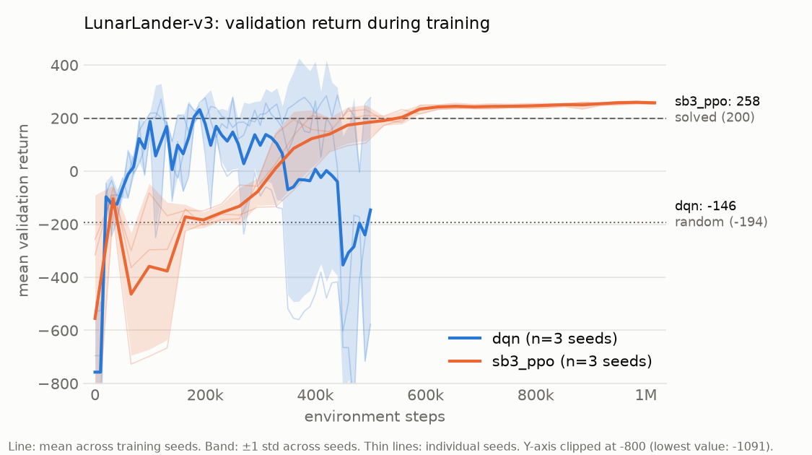

# lunar-lander-rl

**Deep Q-Networks and Proximal Policy Optimization implemented from scratch in PyTorch to solve Gymnasium's `LunarLander-v3`, with multi-seed evaluation, ablations and robustness tests.**

| Random agent | DQN (from scratch) | PPO (SB3 baseline) |
|:---:|:---:|:---:|
|  |  |  |

All three GIFs show the same episode: the first test seed (10000), not a hand-picked one.

<!-- TODO phase 3: add the from-scratch PPO agent. -->

This is not another stable-baselines3 tutorial. The goals of the project are:

1. **From-scratch implementations** of DQN and PPO in PyTorch. Stable-Baselines3 is used only as a reference baseline.
2. **Experimental rigor**: several training seeds, mean ± std, and evaluation on episode seeds that are disjoint from the ones used for training and model selection.
3. **Ablations**: target network, network size, learning rate, ...
4. **Robustness**: train without wind, evaluate under wind and turbulence.
5. **Reproducibility**: everything is driven by YAML configs and fixed seeds.

## Status

| Phase | Content | Status |
|---|---|---|
| 1 | Setup, random agent, SB3 PPO baseline, evaluation pipeline, GIFs | ✅ done |
| 2 | DQN from scratch (target: mean return > 200) | ✅ done: 232.0 ± 61.0, unstable across seeds (see below) |
| 3 | PPO from scratch + comparison with SB3 | ⏳ next |
| 4 | Ablations, robustness to wind, final figures | ⬜ |

## Results

Final evaluation: **100 episodes on held-out test seeds 10000–10099**, deterministic (greedy) actions. For trained agents the score is averaged per training seed, and the ± is the standard deviation **across training seeds** (how reliable the algorithm is), not across episodes.

| Agent | Train seeds | Mean return | Success rate (return ≥ 200) |
|---|:---:|---:|---:|
| Random | – | -194.3 ± 121.4 *(std over episodes)* | 0% |
| SB3 PPO (baseline) | 3 | **258.7 ± 4.5** | 99.7% |
| DQN (ours) | 3 | **232.0 ± 61.0** | 87.7% |
| PPO (ours) | – | <!-- TODO phase 3 --> | |

Per training seed on the test seeds:

| Agent | Seed 0 | Seed 1 | Seed 2 | Wall-clock per seed |
|---|---:|---:|---:|---:|
| SB3 PPO (1M steps) | 259.1 | 254.0 | 263.0 | ~9 min |
| DQN (500k steps) | 266.1 | 161.6 | 268.3 | ~53 min |

Timings are on a laptop CPU (Ryzen 9 6900HX), three seeds in parallel. DQN is slower in wall-clock time despite using half the environment steps: it performs one gradient update per environment step, while PPO collects 16k steps and then updates in large batches.

### Key findings so far

- **DQN learns faster per environment step, PPO is far more reliable.** The mean validation return across seeds first exceeds 200 after 180k steps for DQN and after about 560k steps for PPO. But PPO's three seeds end within 9 points of each other, while DQN's spread is 107 points.
- **Vanilla DQN collapses.** Two of the three DQN seeds learned to land and then suddenly degraded to returns below -400 (a well-known failure mode of Q-learning, linked to overestimated Q-values and a non-stationary target). Exploration was already at its minimum, so this is not caused by random actions.
- **Checkpoint selection on validation seeds matters.** Evaluated on the same test seeds, the *final* DQN weights score **-128.5 ± 402.8**, while the *best-on-validation* checkpoints score **232.0 ± 61.0**. The validation seeds are disjoint from the test seeds, so this gain is not selection bias on the reported number.
- **One DQN seed misses the bar.** Seed 1's best checkpoint scored 218 on 10 validation episodes but 161.6 on the 100 test episodes (73% success): 10 validation episodes are a noisy basis for selecting a checkpoint when the policy is unstable.

Raw per-episode results are in [`results/eval/`](results/eval) and the summary in [`results/summary.csv`](results/summary.csv).

### Learning curves



Per-algorithm figures: [DQN](results/figures/learning_curve_dqn.png), [SB3 PPO](results/figures/learning_curve_sb3_ppo.png).

<!-- TODO phase 3: add PPO (ours). -->

### Ablations

<!-- TODO phase 4 -->

### Robustness to wind

<!-- TODO phase 4: agents trained without wind, evaluated with enable_wind=True at increasing wind_power / turbulence_power. -->

## Methodology

### Environment

`LunarLander-v3` with discrete actions (do nothing, fire left, fire main, fire right) and an 8-dimensional state: position, velocity, angle, angular velocity and leg contacts. Episodes end on landing, crashing or after 1000 steps. The environment is considered **solved at a mean return of 200**.

### Seed protocol

Three disjoint seed ranges are used, so that no reported number was also used to make a decision:

| Purpose | Seeds | Used for |
|---|---|---|
| Training | 0, 1, 2 | Network initialization, exploration, terrains seen in training |
| Validation | 1000–1009 | Periodic evaluation during training → choosing the best checkpoint |
| Test | 10000–10099 | Final reported numbers only |

Selecting the best checkpoint and reporting its score on the same episodes would overestimate performance (selection bias), the same reason validation and test sets are separated in supervised learning. Every evaluation episode is reset with an explicit seed, so all agents face exactly the same 100 terrains and initial pushes.

### Same evaluation code for every algorithm

Every training loop (SB3 or from scratch) calls the same `PeriodicValidator` ([`validation.py`](src/lunar_rl/validation.py)), which evaluates on the validation seeds, writes the learning-curve CSV and keeps the best checkpoint. Final numbers come from the same `evaluate()` function for every agent, so the curves and the results table are comparable by construction.

### Hyperparameters

Both configurations start from the tuned [RL Baselines3 Zoo](https://github.com/DLR-RM/rl-baselines3-zoo) values for LunarLander. Each YAML file explains its values.

- **SB3 PPO** ([`configs/sb3_ppo.yaml`](configs/sb3_ppo.yaml)): 16 parallel envs, `n_steps=1024`, `gamma=0.999` (the landing bonus arrives late in long episodes), `gae_lambda=0.98`, `ent_coef=0.01`, 1M steps.
- **DQN** ([`configs/dqn.yaml`](configs/dqn.yaml)): MLP 256-256, Adam with lr 6.3e-4, batch 128, replay buffer of 50k transitions, `gamma=0.99`, target network synced every 250 steps, epsilon decayed linearly from 1.0 to 0.1 over 12k steps, Huber loss, gradient clipping at 10. Two deviations from the zoo: a 10k-step warm-up before learning and a 500k-step budget, since the best checkpoint is selected on validation anyway.

### DQN implementation notes

- **`terminated` vs `truncated`.** The replay buffer stores only `terminated`. An episode cut by the 1000-step time limit is not a terminal state, so its TD target still bootstraps from the next state. Mixing the two is a classic bug, and it is covered by a unit test.
- **Double DQN** is implemented as a config flag (`double_dqn: true`) but disabled for the main result. It is a phase-4 ablation.

## Installation

Requires Python 3.11. With [uv](https://docs.astral.sh/uv/) (recommended):

```bash
uv sync
```

Or with pip:

```bash
python -m venv .venv
.venv\Scripts\activate        # Windows  (Linux/macOS: source .venv/bin/activate)
pip install -e . pytest
```

`gymnasium[box2d]` now ships prebuilt Box2D wheels, so neither SWIG nor a C++ compiler is needed.

## Usage

Prefix commands with `uv run` if you use uv.

```bash
# Train on seeds 0, 1, 2 in parallel processes (the algorithm is picked from the config)
python -m lunar_rl.train --config configs/sb3_ppo.yaml --workers 3
python -m lunar_rl.train --config configs/dqn.yaml --workers 3

# Quick smoke test: one seed, 50k steps, any config value can be overridden
python -m lunar_rl.train --config configs/dqn.yaml --seed 0 --set train.total_timesteps=50000

# Evaluate on the 100 held-out test seeds (CSV per model + results/summary.csv)
python -m lunar_rl.evaluate --agent random
python -m lunar_rl.evaluate --agent sb3_ppo --model "models/sb3_ppo/seed_*/best_model.zip"
python -m lunar_rl.evaluate --agent dqn --model "models/dqn/seed_*/best_model.pt"

# Evaluate under wind
python -m lunar_rl.evaluate --agent sb3_ppo --model "models/sb3_ppo/seed_*/best_model.zip" --wind --wind-power 15 --turbulence-power 1.5

# Learning curve (mean ± std across seeds) -> results/figures/
python -m lunar_rl.plot_curves --algo sb3_ppo
python -m lunar_rl.plot_curves --algo dqn sb3_ppo   # several algorithms on the same axes

# Record a GIF
python -m lunar_rl.record --agent sb3_ppo --model models/sb3_ppo/seed_0/best_model.zip --out assets/sb3_ppo.gif

# Training curves in TensorBoard
tensorboard --logdir runs

# Tests
pytest
```

<!-- TODO phase 4: single "reproduce everything" command. -->

## Project structure

```
src/lunar_rl/
├── agents/          # Agent protocol, random agent, SB3 adapter, DQN + replay buffer; ppo.py (phase 3)
├── envs.py          # make_env: seeding + wind options
├── train.py         # generic entry point: dispatches on the config's `algo`
├── train_sb3.py     # SB3 PPO baseline
├── train_dqn.py     # DQN training loop
├── validation.py    # periodic validation + best checkpoint, shared by all algorithms
├── evaluate.py      # evaluate any agent on fixed test seeds -> CSV
├── record.py        # GIF of one episode
├── plot_curves.py   # learning curves across seeds
└── utils/           # seeding protocol, config loader, logging
configs/             # one YAML per experiment
results/             # CSVs (curves, evaluations, summary) and figures (versioned)
assets/              # GIFs for this README
tests/
```

Trained models (`models/`) and TensorBoard logs (`runs/`) are not versioned; they are regenerated by the training command.

## License

[MIT](LICENSE)
